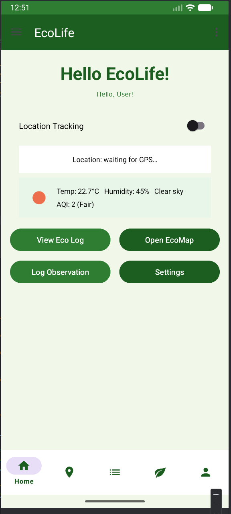
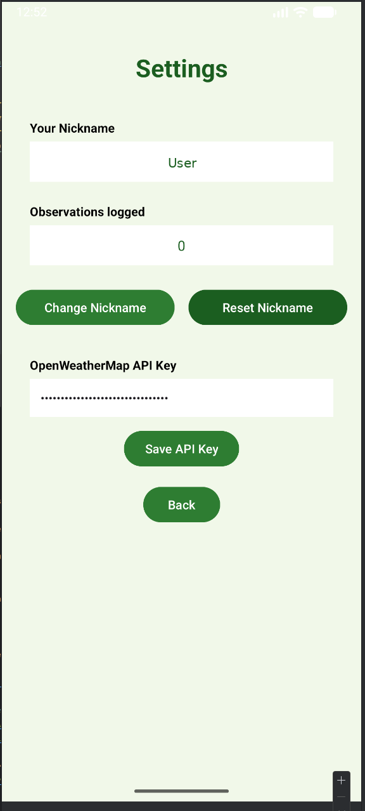
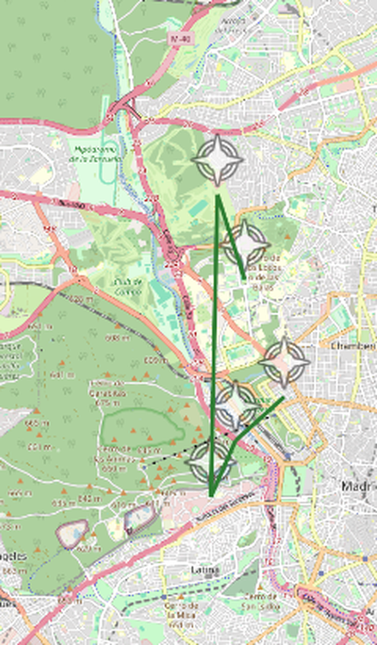
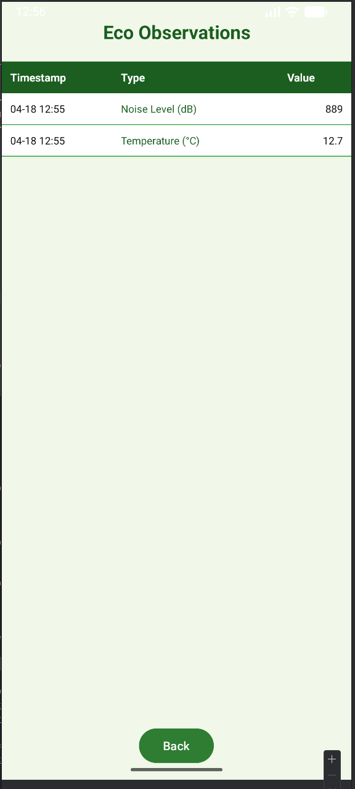
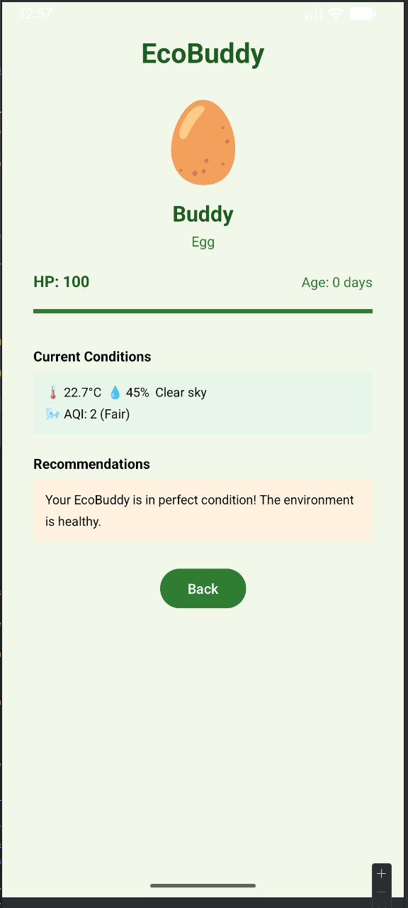
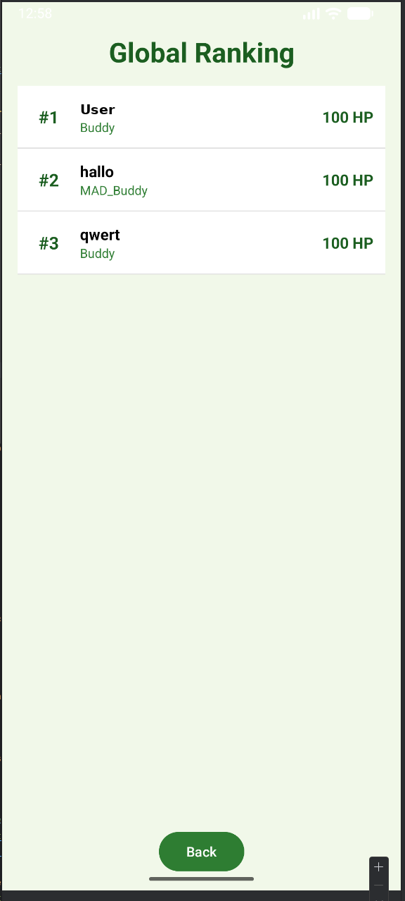

# EcoLife

## Description

EcoLife is a gamified environmental awareness Android app developed for the Mobile App Development course at UPM (2026). The core idea is simple: raise a virtual eco-creature called an **EcoBuddy** whose health reflects the environmental quality of your surroundings. The app tracks your GPS location, logs environmental observations, visualises eco-friendly green spaces on an interactive map, and connects to the OpenWeatherMap API and Firebase to score your EcoBuddy in real time based on temperature, humidity, and air quality data.

EcoLife is inspired by the **Climate Cube** methodology: three categories of environmental topics (Red = threats, Yellow = impacts on living things, Green = solutions) drive the game mechanics and the recommendations shown to the user. Unlike generic fitness trackers, EcoLife focuses on environmental literacy — nudging users to make small, measurable improvements to the spaces they inhabit every day. There is no direct equivalent on Google Play that combines GPS tracking, real-time air quality scoring, and a Tamagotchi-style virtual pet in a single educational package.

## Screenshots and navigation

|                                   |                                      |
|-----------------------------------|--------------------------------------|
|   |        |
| Login Screen                      | Login Form                           |
|    |   |
| Home Screen                       | Settings Screen                |
|  |  |
| OpenStreetMap Screen              | Eco Observations Screen              |
|      |    |
| Eco Buddy Screen                  | RankingScreen                        |

## Features

List of the **functional** features of the app:

- Real-time GPS location tracking with on/off toggle.
- Automatic saving of GPS coordinates (latitude, longitude, altitude, timestamp) to local storage.
- Scrollable log of all recorded coordinates and manual observations.
- Interactive OpenStreetMap with user position and eco-POI markers for green spaces in Madrid.
- Green polyline eco-trail connecting all eco-friendly locations.
- Manual eco-observation diary (temperature, noise, air quality) via AlertDialog input.
- User nickname persisted via SharedPreferences; editable from Settings.
- Real-time weather and air quality data via OpenWeatherMap REST API.
- EcoBuddy gamification screen with health score and environmental recommendations.
- Global ranking of EcoBuddy scores across users.
- Email and Google sign-in via Firebase Authentication.

List of the **technical** features of the app:

- Persistence in csv/text file (early releases). Ref: [`SecondActivity.kt`](app/src/main/java/com/example/ecolife/SecondActivity.kt)
- Persistence in shared preferences. Ref: [`SettingsActivity.kt`](app/src/main/java/com/example/ecolife/SettingsActivity.kt)
- Persistence in Room database. Ref: [`AppDatabase.kt`](app/src/main/java/com/example/ecolife/room/AppDatabase.kt)
- Firebase Realtime database. Ref: [`EcoBuddyActivity.kt`](app/src/main/java/com/example/ecolife/EcoBuddyActivity.kt), [`RankingActivity.kt`](app/src/main/java/com/example/ecolife/RankingActivity.kt)
- Firebase authentication (FirebaseUI — email + Google). Ref: [`LoginActivity.kt`](app/src/main/java/com/example/ecolife/LoginActivity.kt)
- Maps: OpenStreetMap (`osmdroid`). Ref: [`OpenStreetMapsActivity.kt`](app/src/main/java/com/example/ecolife/OpenStreetMapsActivity.kt)
- RESTful APIs used: OpenWeatherMap https://openweathermap.org/api. Used for current weather and air pollution endpoints scored against EcoBuddy HP.
- Menu: Toolbar, Navigation Drawer, Bottom Navigation Bar. Ref: [`MainActivity.kt`](app/src/main/java/com/example/ecolife/MainActivity.kt)
- Images: Glide library for weather icons loaded from OpenWeatherMap CDN.
- Sensors: GPS coordinates via `LocationManager` + `LocationListener` (5 s / 5 m interval). Ref: [`MainActivity.kt`](app/src/main/java/com/example/ecolife/MainActivity.kt)
- Runtime permissions for `ACCESS_FINE_LOCATION` / `ACCESS_COARSE_LOCATION` with graceful fallback.

## How to Use

Provide instructions on how to get started with the app as user.

1. Launch the app and sign in via email or Google (Firebase Authentication).
2. Enable location tracking by flipping the Switch on the main screen. Grant GPS permission on first use.
3. Live coordinates (latitude, longitude, altitude) appear in the centre card and are automatically saved to the Eco Log.
4. Tap **"Log Observation"** to record a manual environmental reading (temperature, noise, or air quality) with an optional note.
5. Tap **"Open EcoMap"** to view the interactive map with your position and five eco-POIs in Madrid connected by a green trail.
6. Open **EcoBuddy** from the navigation drawer to create/view your virtual creature; its HP updates from live weather and AQI data.
7. Open **Ranking** to see global EcoBuddy scores across all users via Firebase Realtime Database.
8. Use the **Bottom Navigation Bar** or the **hamburger menu** to switch between Home, EcoMap, EcoLog, EcoBuddy, and Settings.
9. In **Settings**, view or change your nickname and review total observations logged.
10. Use the toolbar overflow menu to log out at any time.

## Additional section

**Configuration**

| Requirement | Details |
|---|---|
| Location permission | Granted at runtime on first launch |
| Internet access | Required by OpenStreetMap, OpenWeatherMap, and Firebase |
| OpenWeatherMap API key | Free account at openweathermap.org — enter token in Settings |
| Firebase project | Your own `google-services.json` placed in `app/` (the one in this repo is a placeholder) |

**Connect your own Firebase project**

The original Firebase credentials are **not** included. `app/google-services.json` only contains placeholders, so the app builds but sign-in and the ranking won't work until you replace it:

1. Create a Firebase project and add an Android app with package name `com.example.ecolife`.
2. Enable **Authentication** (Email/Password, optionally Google — add your SHA-1) and **Realtime Database**.
3. Download `google-services.json` and replace `app/google-services.json` with it.

**Minimum SDK:** API 24 (Android 7.0) · **Target SDK:** API 36

**Releases**

| Tag | Name | Key features |
|---|---|---|
| v1.0 | Hello EcoLife | App setup, lifecycle logging, GPS permission, navigation to About screen |
| v2.0 | EcoTracker | Location toggle, altitude tracking, CSV storage, 3-activity navigation, detail view |
| v3.0 | EcoMap | OpenStreetMap, user marker, 5 eco-POI markers, green polyline eco-trail |
| v4.0 | EcoDiary | AlertDialog, SharedPreferences, manual eco-observation logging, settings screen |
| v5.0 | EcoLog & Navigation | Custom ListView adapter, Navigation Drawer, Bottom Navigation, Toolbar |
| v6.0 | EcoWeather & DB | Room database, Retrofit + OpenWeatherMap API, weather display, custom app icon |
| v7.0 | EcoBuddy | Firebase Auth, Realtime Database, gamification screen, EcoBuddy lifecycle, ranking |

## References

External documentation and tutorials consulted while building EcoLife:

1. [Firebase Authentication with FirebaseUI on Android](https://firebase.google.com/docs/auth/android/firebaseui) — used to wire up the email + Google sign-in flow in [`LoginActivity.kt`](app/src/main/java/com/example/ecolife/LoginActivity.kt).
2. [Firebase Realtime Database — Read and write on Android](https://firebase.google.com/docs/database/android/read-and-write) — reference for the ranking sync and observation reports.
3. [Android Developers — Save data in a local database using Room](https://developer.android.com/training/data-storage/room) — basis for the `AppDatabase`, DAOs, and entities under `app/src/main/java/com/example/ecolife/room/`.
4. [Kotlin Coroutines on Android](https://developer.android.com/kotlin/coroutines) — used for `lifecycleScope.launch` around all Room DB operations.
5. [osmdroid OpenStreetMap library — GitHub wiki](https://github.com/osmdroid/osmdroid/wiki) — map tiles, markers, and polyline overlay in [`OpenStreetMapsActivity.kt`](app/src/main/java/com/example/ecolife/OpenStreetMapsActivity.kt).

## Participants

Single-member project (100%).
